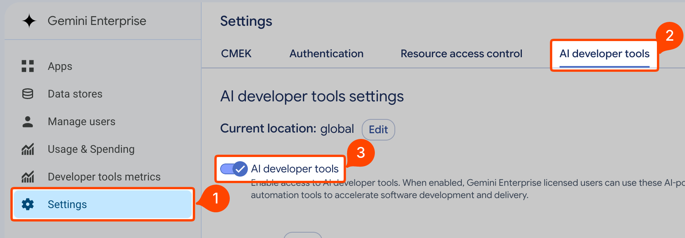
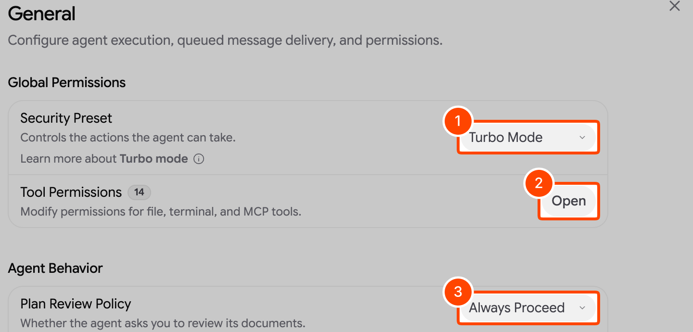
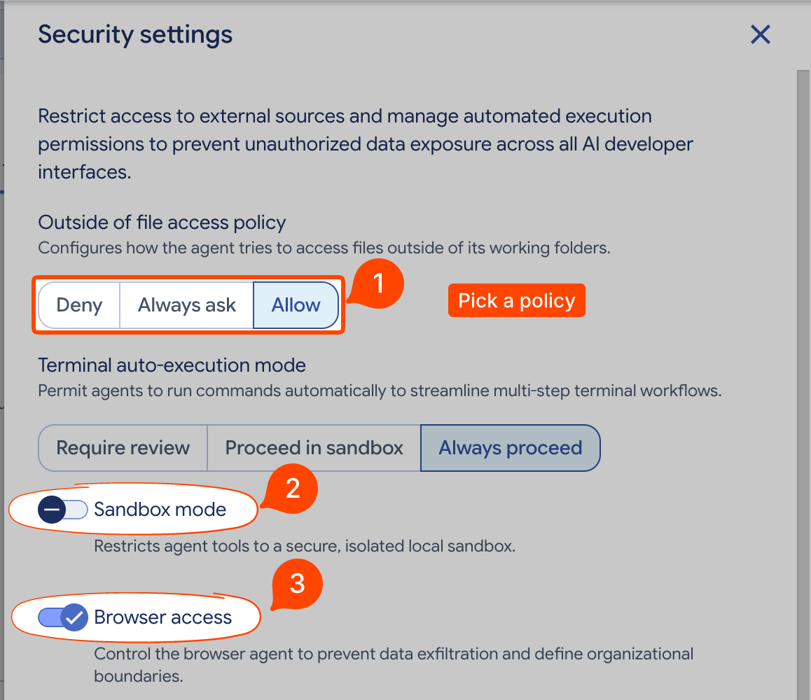
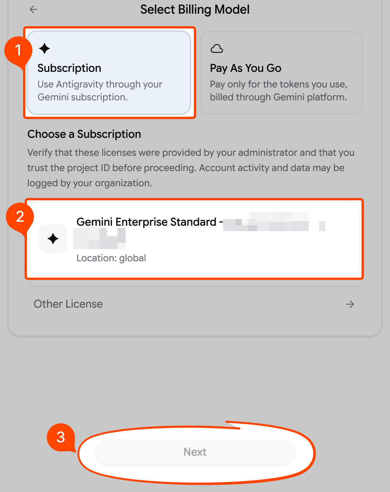
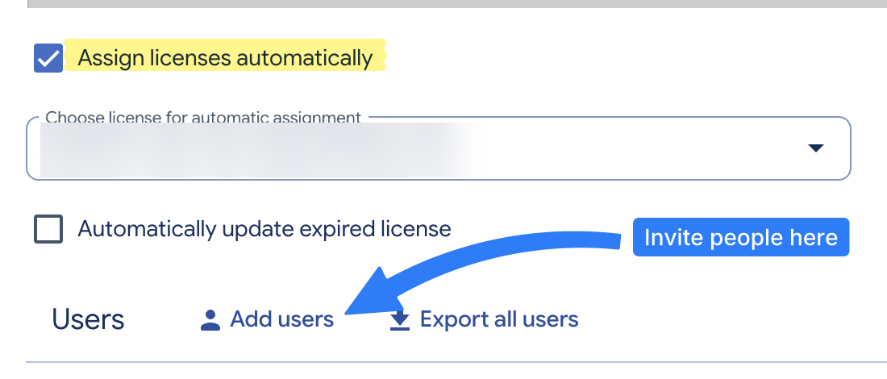

# markshot

markshot draws annotations on a PNG screenshot from a JSON spec, so an AI coding agent can mark up a screenshot for you in one command.

## What does it do?

You (or your agent) describe the annotations as JSON and render them onto the original screenshot:

```sh
cat > spec.json <<'EOF'
{"annotations": [
  {"type": "blur", "rect": [40, 60, 320, 28]},
  {"type": "rect", "rect": [480, 400, 220, 64], "fill": "outline"},
  {"type": "counter", "at": [476, 432], "angle": 0},
  {"type": "arrow", "from": [590, 250], "to": [590, 390]}
]}
EOF
markshot render screenshot.png --spec spec.json -o annotated.png
```

Three commands cover the whole loop:

| Command | What it does |
|---|---|
| `markshot render in.png --spec spec.json -o out.png` | Draws the spec onto the screenshot and writes the PNG, or only the part a top-level `crop` names. |
| `markshot grid in.png -o grid.png` | Overlays a labeled pixel grid for reading coordinates. `--region X,Y,W,H` draws just that part at full size, still labeled in whole-image pixels. |
| `markshot schema` | Prints the JSON schema of the spec, with every field documented. |

`render` also prints a JSON report to stdout:

- `width`, `height`: the input image's size.
- `dpr`: the pixel density used.
- `spec`: the fully resolved spec, with ids, seeds, counter numbers and pixel coordinates filled in.
- `warnings`: anything that did not stop the render.

## What does it look like?

Each image below is one `markshot render` of a real admin-console screenshot, cropped by the spec itself to the part that matters. Click a spec to see every value.

| What the spec does | Result |
|---|---|
| **Numbered steps.** Outline boxes with `"spotlight": true` dim everything else, and each badge uses `"angle": "auto"` to find a free side. `crop` keeps only this part of the page. ([spec](assets/examples/steps.json)) |  |
| **Badges on the corners.** Each `circle` counter sits on its box's corner, and `"ring": true` gives it a white ring so it stands apart from the frame line. ([spec](assets/examples/badges.json)) |  |
| **Hand-drawn ovals sized by markshot.** Each `sketch` oval gives `around`, the toggle's and label's box. With `size` omitted, markshot also picks the thickest line that fits between the description lines. A box frames a button group, and a `text` label says what to do. ([spec](assets/examples/ovals.json)) |  |
| **Redact before sharing.** `blur` pixelates the project ID while boxes and an oval number the steps. ([spec](assets/examples/redact.json)) |  |
| **Highlight and point.** A `highlight` marks a setting, and a curved `arrow` with a `text` label points at a button. ([spec](assets/examples/highlight-arrow.json)) |  |

## What can it draw?

Nine annotation types, all in one spec:

| `type` | Draws | Worth knowing |
|---|---|---|
| `arrow` | An arrow from `from` to `to` | `style`: `shaped`, `sketch` (hand-drawn), `line`, `double`; `via` curves it |
| `rect` | A frame around `rect` | `fill`: `sketch`, `outline`, `semi`, `solid`; `"spotlight": true` dims everything else |
| `oval` | A rounded frame around `rect` | `around`, instead of `rect`, takes the target's box; omit `size` to let the line thin down to fit |
| `blur` | Hides `rect` | `mode`: `pixelate` or `erase` (repaints flat backgrounds) |
| `highlight` | A highlighter stroke | Blends by the brightness of what is under it |
| `spotlight` | Dims everything but `rect` | `shape`: `rect` or `oval`; strength set by the top-level `spotlight_dim` |
| `counter` | A numbered badge | `style`: `bubble`, `pin`, `circle`; `"angle": "auto"` finds a free side; `"ring": true` adds a white ring; `size` 0 to 7 |
| `text` | A short label | `style`: `label` (on a plate) or `plain`; Latin, Greek and Cyrillic only |
| `line` | A straight line | `dash`, and `start_cap` / `end_cap`: `none`, `arrow`, `bullet` |

`size` is a step from 0 to 7 that maps to points, and points scale with the PNG's DPI, so an annotation looks the same on a Retina capture as on a standard one. A counter's diameter, for example, runs 22, 28, 36, 48, 64, 84, 112 and 150 points. [`docs/design.md`](docs/design.md) gives every field and default.

For an oval with `around`, an omitted `size` tries 2, 1, then 0; a size you give stays unchanged. If no candidate fits cleanly, the report warns rather than silently treating it as a clean fit. The resolved spec records the chosen size, rectangle and seed.

## Why use it instead of drawing on the image another way?

An agent can't drag a mouse, but it can write JSON, look at the result and fix one value:

- **Fix by editing.** The resolved `spec` in the output is complete. Change one value and render again from the original, and only that annotation changes. Feed the `spec` back unchanged and you get the same image.
- **Deterministic.** The same input, spec and binary give the same PNG bytes on every supported platform. Randomness, such as hand-drawn jitter and mosaic blocks, is seeded from each annotation's id.
- **Made for screenshots.**
  - Thicknesses are in points and scale with the PNG's DPI.
  - Rectangles, ovals and arrows can look hand-drawn, and an oval can size itself around its target.
  - The highlighter blends by the brightness of what is under it.
  - Badge digits switch between white and black to stay legible.
  - The input's DPI and ICC profile are kept.
- **Clear failures.** An invalid spec exits with code 1, writes nothing, and prints `error: <path>: <message>`, e.g. `error: annotations[0].size: must be 0 to 7, got 9`.

## How do I install it?

### With the install script (recommended)

One command installs the latest release for your machine and checks it against the release's `SHA256SUMS`. Run it again to upgrade in place.

| Platform | Installs into | Command |
|---|---|---|
| macOS (Apple silicon), Linux (x86_64 or arm64, glibc 2.34+) | `~/.local/bin` | `curl -fsSL https://github.com/hypn4/markshot/releases/latest/download/install.sh \| sh` |
| Windows (x86_64 or arm64) | `%LOCALAPPDATA%\Programs\markshot`, added to your user PATH | `powershell -ExecutionPolicy Bypass -c "irm https://github.com/hypn4/markshot/releases/latest/download/install.ps1 \| iex"` |

- `MARKSHOT_VERSION=v0.3.0` installs a particular release.
- `MARKSHOT_INSTALL_DIR` puts it elsewhere.

Then check with `markshot --version`.

### By downloading a binary

Each release on [GitHub Releases](https://github.com/hypn4/markshot/releases) has one self-contained executable per platform, a `SHA256SUMS` file and a build provenance attestation:

| Platform | Asset |
|---|---|
| macOS, Apple silicon | `markshot-aarch64-apple-darwin` |
| Linux x86_64 (glibc 2.34+) | `markshot-x86_64-unknown-linux-gnu` |
| Linux arm64 (glibc 2.34+) | `markshot-aarch64-unknown-linux-gnu` |
| Windows x86_64 | `markshot-x86_64-pc-windows-msvc.exe` |
| Windows arm64 | `markshot-aarch64-pc-windows-msvc.exe` |

1. Save it as `markshot` (`markshot.exe` on Windows) in a directory on your PATH.
2. On macOS and Linux, make it executable: `chmod +x markshot`.
3. On macOS, a binary downloaded with a browser is quarantined and blocked as unsigned. Clear that with `xattr -d com.apple.quarantine markshot`.

The Windows builds link the C runtime statically, so they need no Visual C++ redistributable. `gh attestation verify markshot --repo hypn4/markshot` confirms that GitHub Actions built a file from this repository.

### With Cargo

| Method | Command |
|---|---|
| `cargo binstall`, which downloads the same release binary | `cargo binstall --git https://github.com/hypn4/markshot markshot` |
| Build from source with Rust 1.99 or later, into `~/.cargo/bin` | `cargo install --git https://github.com/hypn4/markshot --locked` |

In a clone, `rust-toolchain.toml` selects Rust 1.99 and `cargo build --release --locked` builds `target/release/markshot`. The release binary is about 3 MB (fat LTO, one codegen unit, stripped).

## How do I teach my AI agent to use it?

Install the bundled skill, [`skills/annotating-screenshots/`](skills/annotating-screenshots/SKILL.md). It follows the [Agent Skills](https://agentskills.io/specification) standard, which Claude Code, Codex, GitHub Copilot, VS Code, Cursor, Gemini CLI and [other agents](https://agentskills.io/clients) load. Once installed, the agent picks it up whenever you ask it to annotate a screenshot. `markshot` itself must be on the agent's PATH.

### With the `skills` CLI

Needs Node.js 22.20+. Run it in your project, or add `-g` to install it for all your projects:

```sh
npx skills add hypn4/markshot --skill annotating-screenshots           # pick the agents interactively
npx skills add hypn4/markshot --skill annotating-screenshots -a claude-code -a codex -y
```

- It copies the skill into `.agents/skills/`, the location agents share, and links it into the folders of agents that use their own (such as `.claude/skills/`).
- `npx skills update` keeps it current; `npx skills remove annotating-screenshots` takes it out.
- From a local clone, use the clone's path instead of `hypn4/markshot`.

### Manually

Copy the whole directory, `SKILL.md` and its `references/`, into a skills folder your agent scans:

| Scope | Shared location (most agents) | Claude Code |
|---|---|---|
| One project | `.agents/skills/annotating-screenshots/` | `.claude/skills/annotating-screenshots/` |
| All your projects | `~/.agents/skills/annotating-screenshots/` | `~/.claude/skills/annotating-screenshots/` |

```sh
mkdir -p ~/.agents/skills && cp -R skills/annotating-screenshots ~/.agents/skills/
```

Project skills take precedence over user skills with the same name. To confirm the agent sees it, list its skills (for example `/skills` in Claude Code or VS Code) or ask it which skills it has.

### What is in the skill?

- **`SKILL.md`:** the render-and-fix workflow, coordinates, a tool picker and common mistakes.
- **`references/`:** every tool with an example, the spec details and defaults, and what each warning means. The agent reads these only when it needs them.

## How is it developed and released?

- [`CONTRIBUTING.md`](CONTRIBUTING.md) explains how to report bugs, propose changes and open pull requests.
- [`AGENTS.md`](AGENTS.md) holds the rules every change follows, for people and AI agents alike: the checks to run, the determinism and spec invariants, and the commit format.
- [`docs/design.md`](docs/design.md) describes the design: the CLI, coordinates, defaults, every tool, the draw order, determinism and colour handling.

| Stage | What happens |
|---|---|
| **CI** | fmt, clippy and rustdoc run once, then the whole test suite runs natively on all five release platforms. The golden images in `tests/golden/` pin the rendering byte for byte, so every platform must draw the same bytes. |
| **Releases** | Pushing a `v*` tag starts them. Each platform builds natively and runs the tests with the shipped release profile; then one job publishes the binaries, `SHA256SUMS`, the attestation and release notes generated from the commits by git-cliff's GitHub template. No changelog file is kept in the repository. |
| **The skill** | `uvx --from skills-ref agentskills validate skills/annotating-screenshots` validates it, and `cargo test` checks its frontmatter, links and examples. [`evals/annotating-screenshots/`](evals/annotating-screenshots/README.md) holds the agent scenarios it was tested with; rerun them after changing the skill. |

## License and notices

- markshot is licensed under the [MIT License](LICENSE).
- Counter labels are laid out with SF Pro's numeric metrics (ascender, descender, digit height and tracking). No SF Pro outlines are included. The digits are drawn with Inter.
- The embedded Inter fonts (`assets/fonts/Inter-Regular.ttf`, `assets/fonts/Inter-Medium.ttf`) are © The Inter Project Authors and licensed under the SIL Open Font License 1.1. See [`assets/fonts/OFL.txt`](assets/fonts/OFL.txt). The fonts inside the binary carry the same copyright and license notice.
